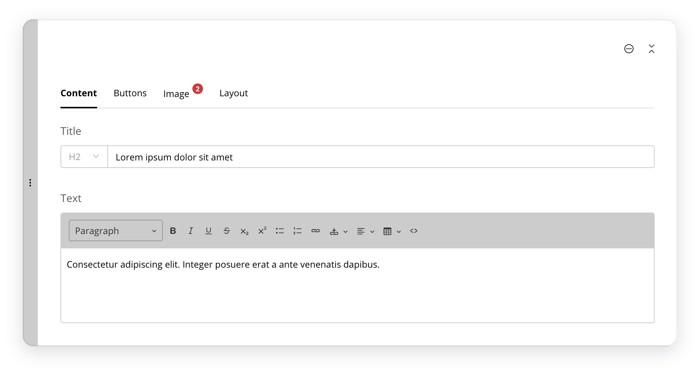

# Sulu Admin UX Bundle

Small improvements to the Sulu 3 admin that make forms quicker to scan and quicker to fill in: tabs in
forms, block types in groups, a headline field with its level built in, read-only fields for detail pages and two
list transformers. How Sulu stores and renders content does not change.

## What's inside

- [**Tabs in forms**](https://sulu.eekes.be/sulu-admin-ux-bundle/tabs): a section named `tabs` shows its child sections as tabs, with an error badge per tab.
- [**Block groups**](https://sulu.eekes.be/sulu-admin-ux-bundle/block-groups): the block type dropdown sorts the blocks under a heading per `<group>` of their template.
- [**`headline`**](https://sulu.eekes.be/sulu-admin-ux-bundle/headline): a heading as one field, with the level (H1 to H6) as a dropdown inside the input.
- [**`table`**](https://sulu.eekes.be/sulu-admin-ux-bundle/table), [**`info_card`**](https://sulu.eekes.be/sulu-admin-ux-bundle/info-card) and [**`text_card`**](https://sulu.eekes.be/sulu-admin-ux-bundle/text-card): read-only fields for the detail pages of your own resources, with [links, badges and HTML](https://sulu.eekes.be/sulu-admin-ux-bundle/value-types).
- [**`link`**](https://sulu.eekes.be/sulu-admin-ux-bundle/link) and [**`money`**](https://sulu.eekes.be/sulu-admin-ux-bundle/money): list transformers that show a URL as a button and an amount in cents as a formatted amount.

## Documentation

[Installation](https://sulu.eekes.be/sulu-admin-ux-bundle/installation) and everything else: **[sulu.eekes.be/sulu-admin-ux-bundle](https://sulu.eekes.be/sulu-admin-ux-bundle)**.

## License

MIT
